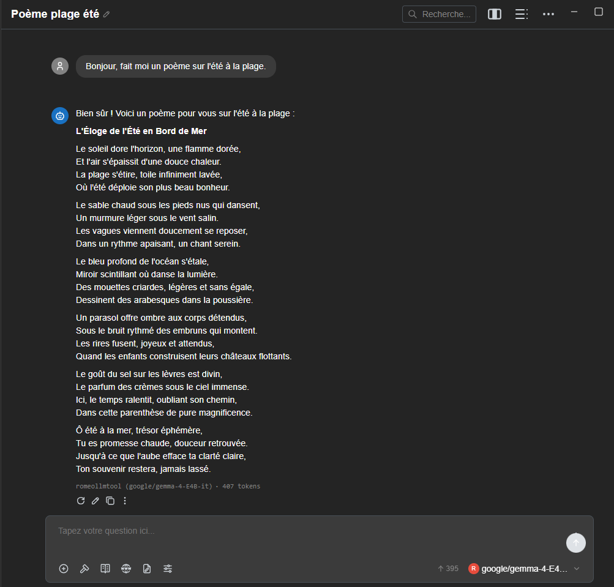

[Sommaire](../../SOMMAIRE.md) › [Accueil](../../index.md) › [Services](../../services.md) › [RomeoLLMTool](../RomeoLLMtool.md) › Utiliser l'API · [Corpus ROMEO](../../README.md) · [Guides MCP](https://github.com/Gotman08/romeo-mcp/blob/main/docs/README.md) · [Tools](https://github.com/Gotman08/romeo-mcp/blob/main/docs/Tools.md)

# Utiliser l'API

La gateway (`romeollmtool gateway start`) expose une API compatible OpenAI :
une seule URL et une seule clé donnent accès à tous les modèles que vous avez
lancés, quel que soit leur moteur. C'est le point d'entrée à utiliser depuis
un autre outil.

## URL et clé[​](#url-et-clé "Lien direct vers URL et clé")

```bash
romeollmtool gateway start      # affiche l'URL
romeollmtool gateway show-key   # affiche la clé API
```

L'URL a la forme `http://<nœud de connexion>:<port>/v1` (le port est choisi
par la gateway, repris d'une session à l'autre tant qu'il reste libre : voir
[Interface terminal, onglet Gateway](../../services/RomeoLLMtool/gui.md#onglet-gateway)). Dans
l'interface terminal, l'onglet Gateway affiche les deux et permet de copier
l'URL (**y**) ou d'afficher la clé (**k**).

La clé se change à tout moment (`gateway rotate-key`) ; l'ancienne est
refusée immédiatement.

## Endpoints[​](#endpoints "Lien direct vers Endpoints")

| Endpoint | Pour |
| --- | --- |
| `GET /v1/models` | modèles actuellement servis, prêts ou en chargement |
| `POST /v1/chat/completions` | conversation (la plupart des modèles) |
| `POST /v1/completions` | complétion simple |
| `POST /v1/embeddings` | fiche `vllm.task: embed` |
| `POST /v1/rerank`, `/v1/score` | fiche `vllm.task: score` |
| `POST /v1/audio/transcriptions` | fiche `vllm.task: transcription` |
| `POST /v1/audio/speech` | fiche `vllm.omni: true` (TTS) |

Le champ `model` de la requête choisit le modèle (son `served_model_name`, ou
par défaut l'identifiant du modèle). S'il est servi par plusieurs jobs (la
même fiche lancée plusieurs fois), la gateway répartit les requêtes tour à
tour entre eux. Une requête pour un modèle encore en chargement reçoit un
`503` ; pour un modèle inconnu, un `404`.

Pour `/v1/chat/completions` et `/v1/completions`, les valeurs `generation:`
de la fiche (température, `max_tokens`…) sont appliquées par défaut, sans
jamais écraser ce que la requête précise explicitement.

## Exemple : client Python (openai)[​](#exemple--client-python-openai "Lien direct vers Exemple : client Python (openai)")

```python
from openai import OpenAI

client = OpenAI(
    base_url="http://<nœud de connexion>:<port>/v1",
    api_key="<romeollmtool gateway show-key>",
)
response = client.chat.completions.create(
    model="google/gemma-4-E4B-it",
    messages=[{"role": "user", "content": "Bonjour"}],
)
print(response.choices[0].message.content)
```

## Exemple : curl[​](#exemple--curl "Lien direct vers Exemple : curl")

```bash
curl http://<nœud de connexion>:<port>/v1/chat/completions \
  -H "Authorization: Bearer $(romeollmtool gateway show-key)" \
  -H "Content-Type: application/json" \
  -d '{"model": "google/gemma-4-E4B-it", "messages": [{"role": "user", "content": "Bonjour"}]}'
```

## Exemple : OpenCode[​](#exemple--opencode "Lien direct vers Exemple : OpenCode")

[OpenCode](https://opencode.ai) accepte n'importe quel fournisseur compatible
OpenAI via `@ai-sdk/openai-compatible`. Dans `opencode.json` du projet :

```json
{
  "$schema": "https://opencode.ai/config.json",
  "model": "romeo/google/gemma-4-E4B-it",
  "provider": {
    "romeo": {
      "npm": "@ai-sdk/openai-compatible",
      "name": "romeollmtool (ROMEO)",
      "options": {
        "baseURL": "http://<nœud de connexion>:<port>/v1",
        "apiKey": "{env:ROMEOLLMTOOL_GATEWAY_KEY}"
      },
      "models": {
        "google/gemma-4-E4B-it": { "name": "Gemma 4 E4B" }
      }
    }
  }
}
```
```bash
export ROMEOLLMTOOL_GATEWAY_KEY=$(romeollmtool gateway show-key)
```

L'identifiant `romeo` du fournisseur est libre ; chaque clé de `models` doit
reprendre exactement l'identifiant du modèle tel qu'il apparaît dans
`romeollmtool gateway status` ou `GET /v1/models`. Le même principe
s'applique à tout autre outil acceptant un fournisseur OpenAI personnalisé
(base URL et clé API à configurer).

> ⚠️ **Attention**
>
> astuce

Un identifiant de modèle qui ne correspond à rien donne un `404` (voir
« Endpoints » plus haut). En cas d'erreur, vérifiez-le d'abord contre
`GET /v1/models` avant de chercher ailleurs.



---

← [Moteurs](engines.md) | → [RomeoGit](../romeogit.md)

## Dans cette section

[↑ Haut de page](#utiliser-lapi) · [Sommaire officiel](../../SOMMAIRE.md) · [Guide du corpus](../../README.md)
