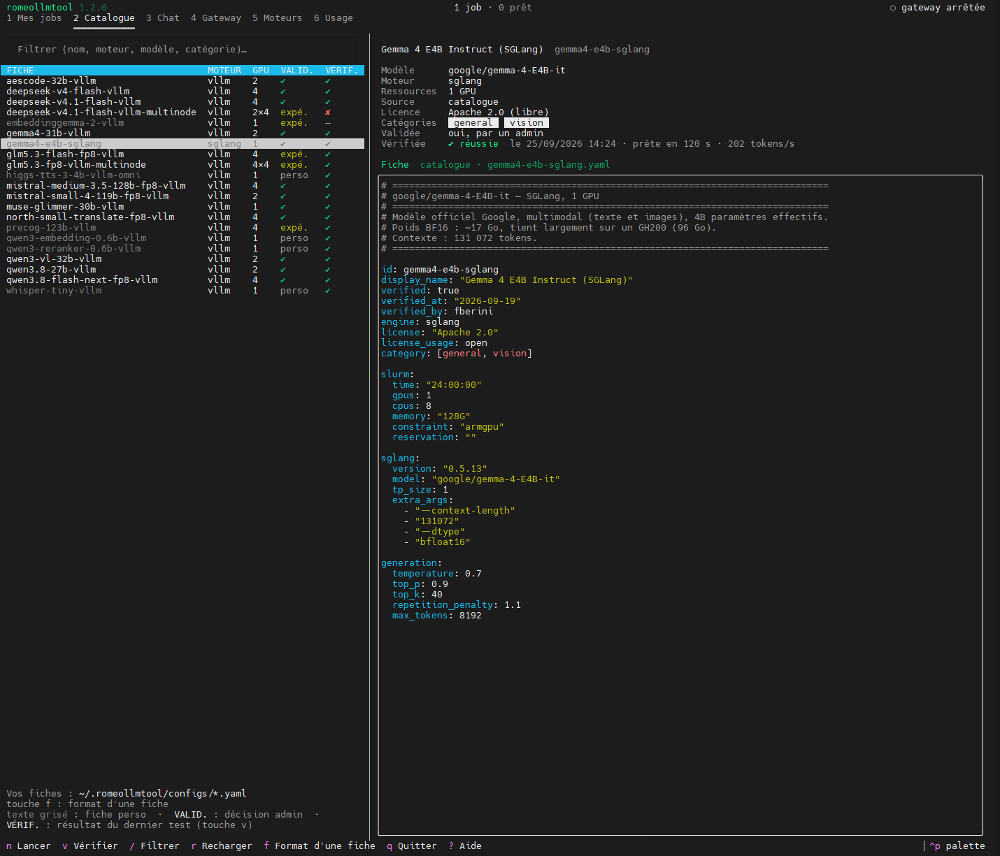
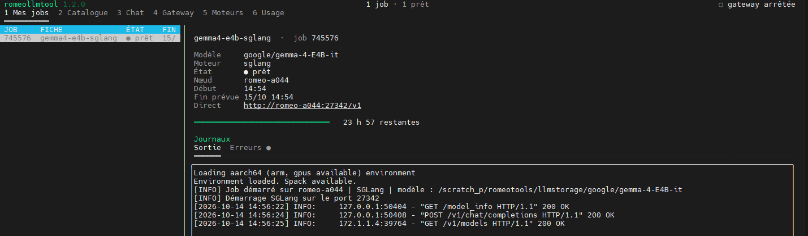
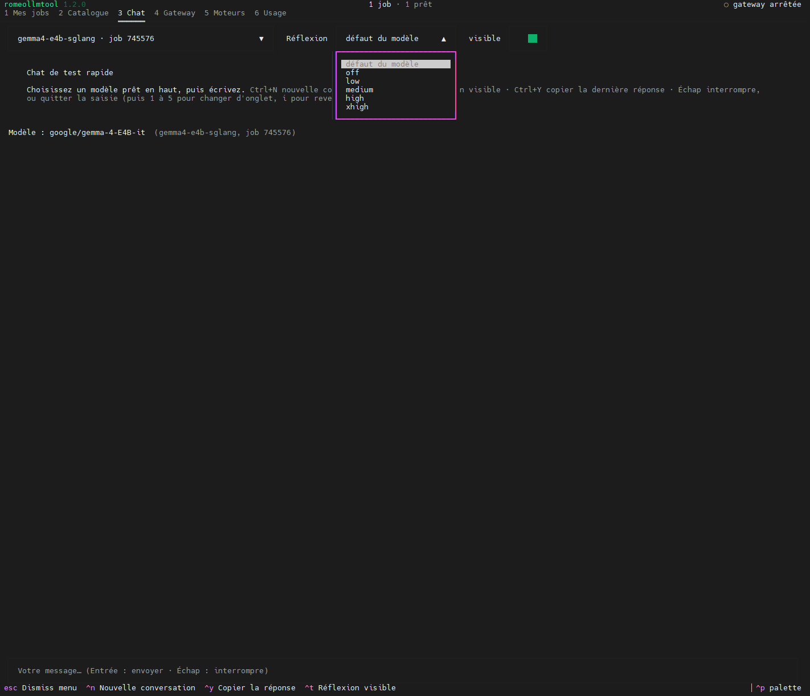
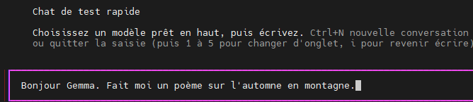
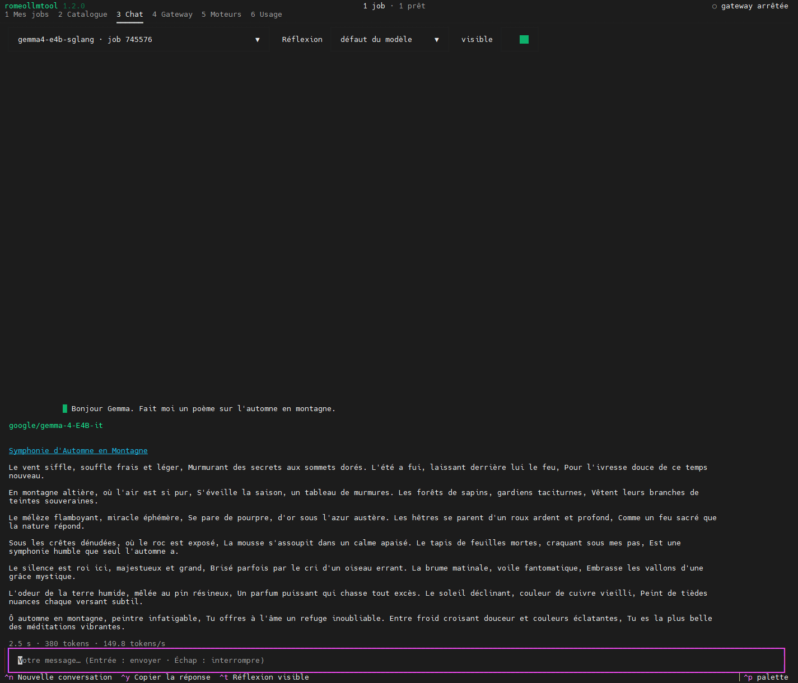
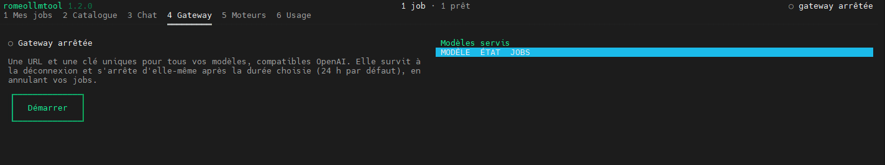
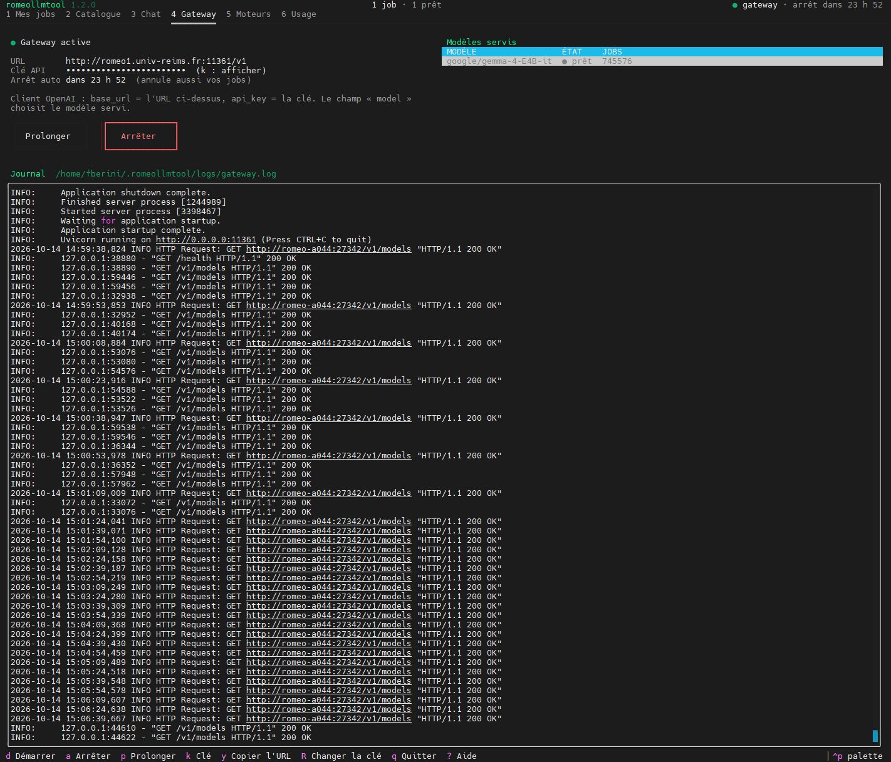
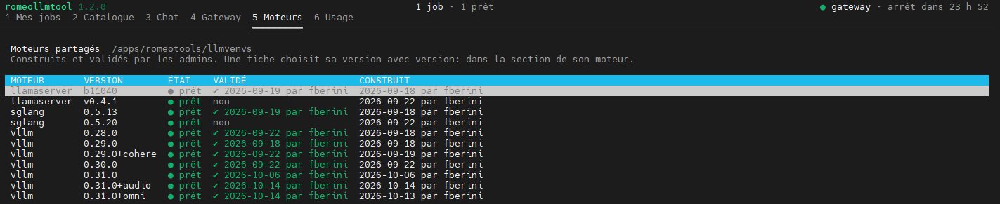

[Sommaire](../../SOMMAIRE.md) › [Accueil](../../index.md) › [Services](../../services.md) › [RomeoLLMTool](../RomeoLLMtool.md) › Interface terminal · [Corpus ROMEO](../../README.md) · [Guides MCP](https://github.com/Gotman08/romeo-mcp/blob/main/docs/README.md) · [Tools](https://github.com/Gotman08/romeo-mcp/blob/main/docs/Tools.md)

# Interface terminal

`romeollmtool` sans argument ouvre l'interface terminal. Elle fonctionne aussi
bien dans tmux et GNU screen que dans un terminal classique, entièrement au
clavier (la souris fonctionne en plus).

Raccourcis valables partout : **1 à 6** changent d'onglet, **Ctrl+P** ouvre la
palette de commandes (recherche sur toutes les actions disponibles), **?**
affiche l'aide, **q** ou **Ctrl+Q** quitte. Dans tmux : `set -g mouse on` pour
la souris, `set -sg escape-time 10` pour une touche Échap réactive.
Les copies dans le presse-papier (`y`, `Ctrl+Y`) passent par le terminal
(OSC 52) : sous tmux, `set -g set-clipboard on`.

La barre du haut affiche la version, le nombre de jobs en cours et leur état,
l'état de la gateway, et une pastille si `romeollmtool doctor` a quelque
chose à signaler (cliquable, ou Ctrl+P).

## Onglet Catalogue[​](#onglet-catalogue "Lien direct vers Onglet Catalogue")

Liste les fiches du catalogue partagé et vos fiches perso
(`~/.romeollmtool/configs/*.yaml`), dans une seule table :

| Colonne | Sens |
| --- | --- |
| FICHE | identifiant de la fiche (nom du fichier) |
| MOTEUR | vllm, sglang ou llamaserver |
| GPU | GPU demandés par la fiche |
| VALID. | validation : `✓` (validée par un admin), `✗` (non), `expé.` (expérimentale), `perso` (fiche perso, non validable) |
| VÉRIF. | résultat du dernier `verify` : `✓`, `✗`, ou `—` si jamais vérifiée |

Les fiches perso apparaissent en gris dans la liste, pour les distinguer du
catalogue partagé d'un coup d'œil.

Raccourcis : **/** filtre (sur le nom, le moteur, le modèle ou une
catégorie), **↑↓** parcourt la liste, **Entrée** ou **n** lance la fiche
sélectionnée, **v** la vérifie, **r** recharge, **f** ouvre le format d'une
fiche ([Écrire une fiche](../../services/RomeoLLMtool/fiches.md)) sans quitter l'interface.

Le panneau de droite détaille la fiche sélectionnée : modèle, moteur,
ressources, source, licence, catégories, statut de validation, résultat de
la dernière vérification, description, puis le YAML complet (fiche du
catalogue, votre override perso, ou les deux fusionnés si vous avez les
deux).

### Lancer une fiche[​](#lancer-une-fiche "Lien direct vers Lancer une fiche")

**Entrée**, **n**, ou la commande « Lancer » de la palette ouvrent une
fenêtre qui demande :

- le **code projet** (compte Slurm sur lequel le job est imputé), obligatoire
  (une liste déroulante propose vos codes ; un seul code : il est déjà
  choisi) ;
- la **durée maximale** du job (24 h au plus) ;
- une **réservation Slurm**, facultative.

Une fiche `verified: experimental` affiche sa réserve avant de confirmer. Une
fois soumis, l'interface bascule sur l'onglet **Mes jobs** et sélectionne le
job créé.

> ⚠️ **Attention**
>
> Lancer la même fiche plusieurs fois

Rien ne l'empêche. Chaque lancement crée un job Slurm distinct ; l'onglet
Mes jobs les affiche tous sous le même nom de fiche, avec des numéros de job
différents. Si vous passez par la gateway, les requêtes pour ce modèle sont
réparties tour à tour entre tous les jobs qui le servent (plus de débit
disponible, ou un modèle en réserve pendant qu'un autre recharge). Pour
arrêter l'un d'eux précisément, sélectionnez-le dans la liste avant
d'appuyer sur **s** : contrairement à `romeollmtool stop <fiche>` en CLI,
qui refuse si le nom désigne plusieurs jobs et demande le numéro voulu,
l'interface n'a pas ce problème puisque vous choisissez déjà la ligne.

### Vérifier une fiche[​](#vérifier-une-fiche "Lien direct vers Vérifier une fiche")

**v**, ou « Vérifier » dans la palette, lance un vrai job, teste qu'il répond
correctement, puis l'arrête et écrit un rapport. Les contrôles : refus sans
clé API, modèle exposé sous le bon nom, réponse à une question simple,
streaming, et une image si la fiche est en catégorie `vision` (pour une
fiche d'un autre type : embeddings, classement, transcription, synthèse
vocale, l'endpoint concerné est appelé directement). Une fenêtre affiche la
progression en direct ; la fermer laisse la vérification continuer en
arrière-plan, le bouton Arrêter annule le job. Le résultat (réussi ou non) et
le chemin du rapport s'affichent à la fin, et la colonne VÉRIF. du catalogue
se met à jour.

Vérifier une fiche du catalogue ignore votre override perso éventuel : c'est
la fiche telle que les autres utilisateurs la lanceront qui est testée.

## Onglet Mes jobs[​](#onglet-mes-jobs "Lien direct vers Onglet Mes jobs")

Vos jobs romeollmtool en cours, retrouvés à chaque fois via `squeue` : aucun
fichier d'état à recharger pour savoir ce qui tourne. Deux exceptions, dans
`~/.romeollmtool/run/<job>.port` et `.json` : le port, choisi par le job
lui-même une fois démarré (Slurm ne permet pas de le faire remonter par
`squeue`, le commentaire du job étant fixé à la soumission, avant que le
port soit connu), et quelques valeurs par défaut de la fiche (`generation:`,
`omni`) écrites par `launch`, utilisées par la gateway et pour afficher un
job après sa fin (voir plus bas). Ces deux fichiers sont supprimés quand vous
arrêtez ou retirez le job ; s'il plante sans que vous le fassiez, ils
restent (et sont nettoyés automatiquement après un long délai, pour éviter
une accumulation sans fin).

La liste : numéro de job, fiche, état, fin prévue. Les états : `○` en attente, `◐` chargement du modèle, `●` prêt,
`×` en train de s'arrêter, `■` planté.

Le détail du job sélectionné montre le modèle, le moteur, l'état, le nœud, le
début et la fin prévue (avec une barre de progression du temps restant), et
ses journaux.

Un job terminé (planté, ou annulé ailleurs) reste affiché (c'est le `.json`
mentionné plus haut qui permet de retrouver sa fiche une fois qu'il a
disparu de `squeue`) jusqu'à ce que vous le retiriez (**d**), ce qui
supprime ces deux fichiers. Ses journaux, eux, restent lisibles
indépendamment : ce sont des fichiers séparés, dans
`~/.romeollmtool/logs/`, non touchés par ce retrait. La touche **s** arrête
un job actif.

**Journaux** : un onglet Sortie et un onglet Erreurs, toujours dans l'ordre
où les lignes arrivent (jamais mélangées). Une pastille marque l'onglet
laissé de côté quand il reçoit de nouvelles lignes ; l'onglet ouvert
automatiquement est celui dont le fichier a bougé en dernier, ce qui met en
avant les erreurs de chargement ou, une fois le modèle en service, sa sortie.
Raccourcis : **l** va aux journaux, **o** bascule entre Sortie et Erreurs.

Autres actions : **e** affiche comment joindre le job (gateway si active,
accès direct pour déboguer, avec sa clé interne masquée par défaut), **c**
ouvre une conversation de test dans l'onglet Chat (modèle prêt uniquement),
**r** rafraîchit la liste.

## Onglet Chat[​](#onglet-chat "Lien direct vers Onglet Chat")

Conversation de test rapide avec un modèle prêt, choisi dans le menu
déroulant en haut. Parle directement au moteur avec sa clé interne : **marche
même sans gateway**. Les valeurs `generation:` de la fiche (température,
`max_tokens`…) sont appliquées comme le ferait la gateway, sans jamais
écraser un réglage que vous changez ici.

Barre du haut : modèle, niveau de réflexion (`reasoning_effort` : défaut du
modèle, off, low, medium, high, xhigh selon le modèle), et un interrupteur
pour afficher ou masquer la réflexion.

Raccourcis : **Entrée** envoie, **Échap** interrompt une réponse en cours ou
quitte la zone de saisie (puis 1 à 6 refonctionnent pour changer d'onglet),
**i** revient à la saisie, **Ctrl+N** ouvre une nouvelle conversation,
**Ctrl+T** bascule la réflexion visible, **Ctrl+Y** copie la dernière
réponse.

## Onglet Gateway[​](#onglet-gateway "Lien direct vers Onglet Gateway")

État de la gateway, URL, clé API (masquée par défaut, **k** l'affiche),
modèles actuellement servis (prêt ou en chargement, avec leurs jobs), et le
journal de la gateway en direct.

Boutons (ou raccourcis **d** démarrer, **a** arrêter, **p** prolonger,
**R** changer la clé, **y** copier l'URL) :

- **Démarrer** : propose une durée de vie (24 h maximum) et un port. Laisser
  le port vide est conseillé : la gateway reprend celui de sa session
  précédente s'il est encore libre, ce qui garde l'URL stable pour vos
  clients ; sinon elle en choisit un autre dans la plage 11301-11399 et vous
  le signale.
- **Prolonger** : repousse l'arrêt automatique sans redémarrer (donc sans
  changer l'URL ni interrompre les requêtes en cours).
- **Arrêter** : coupe la gateway et, sauf case « Garder mes jobs » cochée,
  annule aussi tous vos jobs romeollmtool.
- **Changer la clé** (rotation) : l'ancienne clé est refusée immédiatement.

> ⚠️ **Warning**
>
> attention

Arrêter la gateway annule aussi tous vos jobs romeollmtool, sauf si vous
cochez « Garder mes jobs ».

La gateway est un service `systemd --user` qui survit à votre déconnexion du
cluster et s'arrête de lui-même à l'échéance choisie (en annulant vos jobs,
sauf extension). Voir [Utiliser l'API](../../services/RomeoLLMtool/api.md) pour s'en servir depuis un
autre outil.

**Comment le port est choisi** : aucune fiche ni aucun job ne fixe de port à
l'avance, des utilisateurs différents peuvent partager un même nœud de
calcul sans se gêner. Chaque job tire un port libre au démarrage et le
publie ; la gateway, elle, écoute sur un port fixe de la plage 11301-11399 du
nœud de connexion, repris d'une session à l'autre tant qu'il reste libre,
pour que vos clients n'aient pas à changer d'URL à chaque redémarrage.

## Onglet Moteurs[​](#onglet-moteurs "Lien direct vers Onglet Moteurs")

Liste en lecture seule des moteurs partagés, construits et validés par les
administrateurs (`/apps/romeotools/llmvenvs/`) : moteur, version, état
(`prêt` ou `incomplet`), validation (par qui), date de construction. Une
fiche choisit sa version avec `version:` dans la section de son moteur. Voir
[Moteurs](../../services/RomeoLLMtool/engines.md) pour le détail des trois moteurs et de leurs
variantes.

## Onglet Usage[​](#onglet-usage "Lien direct vers Onglet Usage")

Vos GPU-heures (toujours à jour, lues de Slurm) et le nombre de requêtes
passées par la gateway, par fiche, sur les 7 derniers jours. Les requêtes
sont absentes pour un job appelé directement sans passer par la gateway.

## Permissions (« doctor »)[​](#permissions--doctor- "Lien direct vers Permissions (« doctor »)")

romeollmtool ne se protège pas lui-même : la sécurité tient entièrement aux
permissions Unix de vos secrets, de vos fiches perso, et des dossiers
partagés. La pastille de la barre du haut signale quand quelque chose est à
corriger ; cliquer dessus (ou Ctrl+P puis « Permissions ») ouvre le détail :
chemin concerné, problème, à qui revient la correction (vous ou un admin), et
la commande exacte à lancer. Équivalent en CLI : `romeollmtool doctor`
(voir [Ligne de commande](../../services/RomeoLLMtool/cli.md)).

---

← [RomeoLLMTool](../RomeoLLMtool.md) | → [Ligne de commande](cli.md)

## Dans cette section

[↑ Haut de page](#interface-terminal) · [Sommaire officiel](../../SOMMAIRE.md) · [Guide du corpus](../../README.md)
